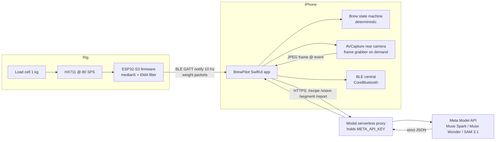

# BrewPilot — AI Pour-Over Coach

**Project spec v0.1** · Meta Global AI Developer Hackathon (Cerebral Valley) · Kickoff Oct 26 → submissions due **Nov 4, 9:00 PM ET**

> Working title. Alternatives: Mirror Barista, Pour Copilot. Decide before submitting.

---

## 1. Pitch

A smart brewing rig for home coffee: a **Bluetooth ESP32 scale** sits under your Melitta dripper, your **iPhone is propped facing the brew** with its camera watching, and an **AI coach watches both the camera and the weight stream** to guide you through a pour-over in real time — when to pour, how fast, when to stop, and what you did wrong.

One sentence for judges: **"Your phone becomes a barista looking over your shoulder — it sees your brew and weighs it at 10 Hz while Meta's vision models coach you in real time."**

Theme fit: **"Build for Your World"** — a domain problem I know firsthand (home pour-over is easy to do badly; technique feedback today requires a human teacher or a $300 smart scale + years of practice).

---

## 2. Hackathon constraints (drives design)

| Constraint | Implication |
|---|---|
| Must build with Meta's newest models via the **Meta Model API** (per event page: Muse Spark series, Muse Wonder, Muse Image, SAM 3.1) | Vision reasoning → Muse Wonder (VLM); segmentation → SAM 3.1; recipe/text generation → Muse Spark; demo assets → Muse Image. **Verify exact model IDs + API shape at kickoff; the page summary may paraphrase.** |
| 10 days, fully remote, submission Nov 4 9 PM ET | Everything must run on my desk; no shipping-dependent hardware beyond what I order **before Oct 26** |
| Indie track judged on: creativity, technical ambition, **works end-to-end** | Hardware + firmware + iOS + multimodal AI is high ambition; MVP must complete one real guided brew, live, on camera |
| Inference credits: Baseten $100 / Modal $100 / Fireworks $25 | Host a tiny API-key proxy on one of these; never ship the Meta API key inside the iOS app |

---

## 3. MVP scope

### In scope (MVP = demo-complete)
1. ESP32 BLE scale reporting weight at **10 Hz** (0.1 g resolution after filtering), with a standalone TFT UI at Lunar/Timemore level (manual + auto-pour timer, flow readout, button tare, on-device calibration — all working with no phone).
2. iOS app (SwiftUI) that: connects to the scale, shows live weight / target / timer / flow-rate bar, runs a **deterministic brew state machine**, shows camera preview.
3. Recipe generated by **Muse Spark** from user input (bean roast, cups, strength) as strict JSON.
4. **Event-driven vision checks**: at key moments (bloom start, end of each pour pulse, drawdown, final bed) the app sends one JPEG frame to **Muse Wonder** for technique analysis → coaching message shown/spoken on screen.
5. **SAM 3.1 segmentation** of the coffee bed on the final frame → rendered as a mask overlay in the brew report (visual wow + real signal: bed uniformity).
6. End-of-brew report card: timeline chart (weight + flow), total time, ratio accuracy, AI critique of the spent bed photo.
7. Offline fallback: bundled canned recipe + local coaching logic → the brew still completes if the API is down mid-demo.

### Out of scope (stretch, §13)
Water temperature sensing, voice conversation, Watch app, grind-size detection, in/out dual scales, Android.

### Design principle (say this to judges)
**The AI never sits in the safety-critical loop.** Timing, pour targets, and flow math are deterministic Swift. The AI generates the plan (recipe), perceives the world (camera), and talks to the human (coaching). If every model call fails, the app still brews a good cup.

---

## 4. User experience walkthrough

1. **Setup screen** — app scans for scale, connects. Camera preview with a framing overlay ("keep the dripper inside the box"). User tares from the app (or the TARE button).
2. **Recipe screen** — pick beans (light/medium/dark), cups (1–2), strength (tea-like ↔ strong). Tap *Generate recipe* → Muse Spark returns a pour plan (e.g., 22 g coffee / 350 g water / 94 °C / bloom 45 s / 3 pour pulses). User can tap "regenerate lighter".
3. **Brew screen** (the hero screen) — big live weight number, target line, countdown/stopwatch, **flow-rate bar with green zone**, current instruction ("Pour to 150 g at ~6 ml/s"), coach bubbles that appear from vision checks. Screen never sleeps.
4. **Report screen** — weight/flow chart, ratio + timing stats, SAM-masked final bed photo, AI critique ("bed drained evenly; no channels; you poured 8 g over target on pulse 2"), shareable **Muse Image** brew card (stretch).

---

## 5. System architecture



**Data flow during a brew:**
- Weight: ESP32 → BLE notify (10 Hz) → app → state machine + flow-rate calc. Never leaves the phone.
- Vision: state machine fires an event ("BLOOM_STARTED") → app grabs latest frame, downscales to ~640 px JPEG (~60–100 KB) → proxy → Muse Wonder → JSON observation → coach message. Budget 2–6 s per check; show a subtle "thinking" chip.
- Everything else is local math.

---

## 6. Hardware (BOM — order before Oct 26)

| Item | Suggested | ~Cost | Notes |
|---|---|---|---|
| MCU | ESP32-S3 DevKitC-1 | $10 | Any ESP32 with BLE works; S3 has best antenna |
| Load cell | 1 kg half-bridge, 4× 350 Ω (kit with mounting hardware) | $9 | Whole rig (scale + mug + dripper + water) ≈ 900 g → 1 kg cell. Resolution after filter ≈ 0.2–0.5 g |
| ADC board | HX711 (solder RATE pin high → 80 SPS) | $3 | 80 SPS is what makes 10 Hz output + flow rate possible |
| Power | USB power bank or 18650 + TP4056 | $10 | Battery = scale sits anywhere, no cable snag |
| Misc | Perfboard, dupont wire, M3 standoffs, rubber feet | $10 | |
| Platform | Any kitchen scale body / 3D print / two cutting boards + standoffs | — | Load cell must float between base and top plate, nothing touching the top plate |
| Coffee | Melitta #2 or #4 cone (plastic), filters, burr grinder, gooseneck kettle, 1-cup mug | owned? | The mug+dripper assembly sits ON the scale |
| Display | 1.8" TFT SPI 128×160, ST7735S | owned | Weight/timer/flow UI; Adafruit_ST7735 + GFX |
| Buttons | 2× tactile 6×6 mm + caps (TARE, TIMER) | owned | Active-low, internal pull-ups |

**Rig geometry (one scale, simplest):** scale under mug → dripper on mug → total weight only increases (water in, coffee in). Tare once with dry setup; "water poured" = current weight. No out-flow subtraction needed for the MVP.

**Phone stand:** anything that holds the iPhone at 30–45° above and 25–35 cm from the brewer, rear camera on. Test framing before demo; add on-screen overlay.

---

## 7. Scale firmware spec (`scale/`, PlatformIO + Arduino-ESP32)

**Wiring:** HX711 `VCC → 3V3`, `GND → GND`, `DT → GPIO 16`, `SCK → GPIO 4` (3.3 V keeps HX711's digital lines at ESP32-safe levels and matches its ratiometric reference). HX711 `RATE` pad soldered/jumpered to 3V3 for 80 SPS. Load cell: red `E+`, black `E−`, green `A+`, white `A−` (common kit colors — verify if a reading is wild). Display (ST7735S 1.8" 128×160, hardware SPI): `SCK → GPIO 12`, `MOSI → GPIO 11`, `CS → GPIO 10`, `DC → GPIO 9`, `RST → GPIO 8`, `BL → GPIO 15` (PWM dimming), `VCC → 3V3`, `GND → GND`. Buttons (active-low, `INPUT_PULLUP`, 50 ms debounce): `TARE → GPIO 5`, `TIMER → GPIO 6`. Libraries: Adafruit_GFX + Adafruit_ST7735. If re-wiring, avoid strapping pins 0/3/45/46.

**GATT profile** (custom service, coffee-flavored base UUID — all hex-valid):
```
Base:              0000C0FF-EE00-4000-8000-00DECAFE00xx
Service:           ...0010
Weight  (notify):  ...0011
Tare    (write):   ...0012
Calib   (write):   ...0013   (payload: float known grams → sets scale factor)
Control (write):   ...0014   (0x01 start stream, 0x00 stop, 0x02 set rate byte)
```

**Weight notification payload (10 bytes, little-endian):**
```
u32  seq        — sequence number (drop detection on iOS)
i32  weight_cg  — grams × 100
u8   flags      — bit0: settled (stable ±0.5 g for 1 s), bit1: overload
u8   battery_pct
```

**Signal chain:** HX711 @ 80 SPS → median-of-5 → EMA (α ≈ 0.35) → decimate to 10 Hz notify. Connection interval 15 ms, MTU ≥ 23 (payload is small on purpose). Auto-advertise when disconnected.

**Display layout (128×160 portrait, 10 Hz refresh):** big weight (0.1 g) on top · timer under it · live flow bar with numeric ml/s · status row (mode, BLE link icon, battery) · one-line message area (tare confirm, "TIMER AUTO", errors). Weight/timer redraw at 10 Hz, status row at 2 Hz. Must be legible at 50 cm (arm's length on the brew bar).

**Modes (TIMER long-press cycles MANUAL → AUTO POUR → SET; persisted in NVM):**
- `MANUAL` — weight + manual timer (TIMER short = start/stop; short while stopped resets to zero).
- `AUTO POUR` — pour-over mode à la Timemore auto: timer auto-starts when weight rises > 3 g within 2 s (first pour) and keeps running; flow readout prominent; TIMER press stops; press again while stopped resets. Tare prompt on entering the mode.
- `SET` — settings: units (g/oz), calibration, BLE on/off, brightness, auto-off (5/10/30 min, default 10). Inside: TIMER long = next item, TIMER short = adjust, TARE short = save + exit, TARE long = exit without saving.

**Buttons (global, identical with BLE connected or not):** TARE short = tare (< 0.3 s, screen flashes "TARE"); TARE long (2 s) = toggle g/oz. TIMER short = start/stop (MANUAL), stop (AUTO POUR); TIMER long (2 s) = next mode. Hold TARE + TIMER together (2 s) = deep sleep; TARE press wakes (ESP32-S3 ext0, single pin).

**Calibration flow:** two-point at boot from NVM (zero + one known mass, e.g. a mug of water weighed on a kitchen scale). Expose over the Calib characteristic so it's done from the app, no reflash. Fully doable on-device too: SET → calibration → screen prompts (empty → confirm → place known mass → pick 100/200/500 g preset with TIMER → TARE confirms → saved to NVM).

**Behavior:** tare persists across reconnects; watchdog; if BLE drops mid-brew the app shows "scale lost — pause" (brew pause is safe: coffee just sits). The scale runs fully standalone — display, buttons, timer, and modes never depend on BLE; the app is additive. The screen shows a link icon while a phone is connected; on BLE drop the scale just keeps weighing (no blocking error on the device UI).

**Acceptance:** streamed weight within ±0.5 g of a kitchen scale reference; end-to-end BLE latency < 150 ms; 10 Hz sustained for a full 4-minute brew with zero dropped notifications. Standalone: button tare < 0.3 s; AUTO POUR timer starts ≤ 2 s after the first pour; full brew weighable with the phone in airplane mode; auto-off and wake work; deep-sleep draw negligible next to a brew session.

---

## 8. iOS app spec (`ios/`, SwiftUI, iOS 17+, personal device via free provisioning)

**Permissions (Info.plist):** `NSCameraUsageDescription`, `NSBluetoothAlwaysUsageDescription`. Keep screen awake (`UIApplication.isIdleTimerDisabled = false` only during brew… i.e., true during brew).

### 8.1 Brew state machine (deterministic, in Swift)

```
IDLE → PREP(rinse filter, heat kettle — user confirms)
    → ADD_COFFEE   (wait until weight ≈ recipe.coffee_g ± 2 g; coach if off)
    → TARE         (auto)
    → BLOOM        (pour target_add_g over window; hold duration_s; vision check @ +10 s)
    → PULSE ×N     (pour to target_total_g at flow target; vision check at pulse end)
    → DRAWDOWN     (wait until flow < 0.5 ml/s for 10 s or timeout 90 s)
    → DONE         (final frame → SAM + report)
```

Guard rails (local logic, not AI):
- weight drop > 8 g in < 1 s → rig lifted/moved → pause + "put it back" prompt
- pour overshoot > 5 g past target → coach warning immediately, continue
- scale silent > 1.5 s → reconnect prompt

**Flow rate:** derivative of smoothed weight over a 500 ms sliding window (ml/s). This is the number the pour bar displays; green zone comes from the recipe step.

### 8.2 Camera pipeline
Rear camera, 720p30 `AVCaptureVideoDataOutput`, keep latest frame in a 1-deep buffer. On state-machine event: crop to overlay rect → downscale ~640 px → JPEG q0.6 → upload. **No continuous streaming to the cloud** (latency, cost, privacy). Report screen stores the 4–6 event frames locally.

### 8.3 Screens
Connect · Recipe · Brew · Report (§4). Brew screen layout: weight huge (120 pt), target + delta under it, timer, flow bar, instruction banner, coach bubble stack, camera preview as small PiP (the real coffee is in front of you — the AI is the one that needs the camera, not you).

---

## 9. AI layer spec (`server/` proxy + prompts)

**Proxy:** Modal (or Baseten) serverless FastAPI. Endpoints: `POST /recipe`, `POST /vision`, `POST /segment`, `POST /report`. Holds `META_API_KEY`. 30-line app; deploy day 1, burn credits, keep iOS key-free.

**Rule: every model response must parse as JSON against a schema; on parse failure or timeout → fall back to local logic and continue the brew.**

### 9.1 Recipe generation — Muse Spark
Input: `{roast, cups, strength, coffee_name?}`. Output (strict JSON, temperature-0):
```json
{
  "name": "Bright Sunday Morning",
  "coffee_g": 22, "water_g": 350, "temp_c": 94, "grind": "medium-fine (table salt)",
  "steps": [
    {"id": "bloom", "type": "pour", "target_add_g": 50, "flow_ml_s": [4, 6], "duration_s": 45,
     "instruction": "Saturate all grounds gently. Swirl once."},
    {"id": "p1", "type": "pour", "target_total_g": 150, "flow_ml_s": [5, 7], "duration_s": 30,
     "instruction": "Pour in slow spirals from the center out."},
    {"id": "p2", "type": "pour", "target_total_g": 250, "flow_ml_s": [5, 7]},
    {"id": "p3", "type": "pour", "target_total_g": 350, "flow_ml_s": [4, 6]}
  ]
}
```
Validation: total water == last `target_total_g`, ratio 1:15–1:17, 3–5 steps. Regenerate on violation.

### 9.2 Vision checks — Muse Wonder (VLM), event-driven
Send: single JPEG + step context (`{"step": "bloom", "elapsed_s": 12, "target_g": 50}`). Ask for:
```json
{
  "bloom_active": true, "bubbles": "vigorous",
  "pour_position": "center", "bed_even": true, "channeling": false,
  "coaching": "Great bloom — fresh coffee. Keep the kettle ready for the first pulse at 0:45.",
  "severity": "info"
}
```
Check moments: bloom +10 s · end of each pulse (2–3×) · drawdown · final bed (5–6 calls per brew total). Show `coaching` verbatim as a coach bubble; use the structured fields to gate state transitions *softly* (nudge, never block).

### 9.3 Final bed segmentation — SAM 3.1
Final frame → SAM prompt (text or point prompt at bed center, per API capability at kickoff) → mask → app renders mask overlay tinted by local dryness/pour uniformity heuristics → the report's signature visual. Even a static "did the bed drain flat" check is demo-worthy.

### 9.4 Brew report — Muse Spark
Feed: step timeline + per-step errors (g over/under, ml/s avg) + vision observations → report text (3 bullets + 1 tip) + optional **Muse Image** share card (stretch).

---

## 10. Data contracts summary

| Stream | Format | Cadence |
|---|---|---|
| Scale → app | BLE notify, 10-byte packet (§7) | 10 Hz |
| App event log | local JSON: `{t_ms, state, weight_g, flow_ml_s}` | 10 Hz, local only |
| App → proxy | multipart or base64 JPEG + context JSON | on event (≤6/brew) |
| Proxy → app | JSON per §9 schemas, validated client-side | per call |

---

## 11. Coffee domain cheat-sheet (feeds prompts + defaults)

- Melitta pour-over, 1 cup: **22 g coffee : 350 g water (1:16)**, 94 °C (light roast → 96 °C), medium-fine grind, total brew **2:45–3:30**.
- Bloom: ~2–2.5× coffee weight (50 g), 40–50 s, gentle saturation. Vigorous bubbles = fresh coffee.
- Pours: 3–4 pulses, 4–7 ml/s, spiral center-out, keep slurry level (don't let bed go dry between pulses).
- Defects the VLM can actually see: dry high-and-dry grounds on the wall (pour too center/out), obvious channels/tunnels in spent bed, off-center pouring, way-too-fast pour (fountain), no bloom bubbles (stale coffee), bed drained into a mound (uneven).
- Weight-only signals (no vision needed): overshoot, pour rate, stall (drawdown > 90 s → grind too fine).

---

## 12. Plan (10 days + 3 prep days)

**Now → Oct 25 (pre-kickoff):** order BOM (§6) for arrival by Oct 27; install Xcode + PlatformIO; create repos; test iPhone dev signing on device; request Meta Model API + Modal/Baseten credits access.

| Day | Date | Goal | Done when |
|---|---|---|---|
| 1 | Oct 26 | Kickoff; verify exact model names/API; proxy deployed; ESP32 BLE hello-world | `curl` proxy → real model reply; phone sees BLE advertisements |
| 2 | Oct 27 | Scale hardware assembled (cell + TFT + buttons); firmware streaming | weight on TFT + serial |
| 3 | Oct 28 | Calibration + filtered 10 Hz BLE + standalone modes; iOS central connected | live weight on phone ±0.5 g; button tare/timer work with no phone |
| 4 | Oct 29 | Brew state machine + canned recipe runs locally | full dry-run brew guided with kettle water only |
| 5 | Oct 30 | Recipe gen (Spark) + vision checks (Wonder) wired in | one real coffee brew with AI coach |
| 6 | Oct 31 | Flow-rate bar, guard rails, SAM bed mask in report | E2E brew #2–3, robust |
| 7 | Nov 1 | Report screen, chart, polish UI, offline fallback | demo brew #4 flawless |
| 8 | Nov 2 | Buffer / fix worst bug; Muse Image card (stretch) | — |
| 9 | Nov 3 | **Record demo video** (3 acts: rig reveal 20 s → live brew highlights 90 s → report + SAM mask 30 s) | video done |
| 10 | Nov 4 | Write submission (problem, architecture diagram, how Meta models are used, "does it work" evidence); submit before 9 PM ET | submitted |

**Demo risk rule:** the video shows a *real* live brew (speed-ramped), not a mock. Keep brew #4's rig untouched for filming.

---

## 13. Risks & mitigations

| Risk | Mitigation |
|---|---|
| BLE drops / iOS backgrounding | screen awake, foreground-only app, watchdog + auto-reconnect; notify payload tiny |
| HX711 drift/creep with warm rig | tare right before ADD_COFFEE (post-rinse), 5 min warm-up, nothing hot touches the load cell path |
| Model API latency spikes | event-driven single-frame calls (≤6/brew), local fallback text, "thinking" UI chip |
| Water + electronics | scale electronics under the load plate, kettle pours from the side, towel protocol on desk |
| Exact Meta model IDs unknown today | Day 1 task; swap model names in one config constant |
| Overrun | Day 8 is buffer; cut order: Muse Image card → SAM mask → voice; **never cut** the offline fallback |
| Solo bandwidth (indie track) | firmware is ~600 LOC with the standalone UI (display + buttons + modes); iOS is where the time goes — keep UI to 4 screens |

---

## 14. Stretch goals (post-MVP, in priority order)

1. Voice coach (AVSpeechSynthesizer reading coach messages) — cheap, big demo value.
2. Live SAM 3.1 overlay during brew (segment dripper+slurry each vision event).
3. Water temp via IR sensor (MLX90614 on ESP32, second BLE characteristic).
4. Grind-size check (photo of grounds on white paper → VLM vs. reference).
5. Brew history + "dial-in" tracking across brews (same beans → suggest grind/temp changes).
6. Muse Image shareable brew card.

---

## 15. Repo layout

```
hackathon/
├── SPEC.md          ← this file
├── scale/           ← ESP32-S3 + HX711 BLE scale (PlatformIO, Arduino framework)
├── ios/BrewPilot/   ← Xcode project (SwiftUI)
├── server/          ← Modal proxy (FastAPI, one file)
└── docs/            ← rig photos, demo script, submission checklist
```

---

## Appendix A — MVP acceptance checklist (judge "it works" evidence)

- [ ] Scale streams 10 Hz, ±0.5 g, whole brew, zero drops
- [ ] Phone connects < 3 s; live weight latency feels instant
- [ ] Standalone parity: button tare, AUTO POUR timer, flow readout, on-device calibration — all work with no phone
- [ ] TFT shows weight (10 Hz), timer, flow, BLE/battery status; legible at arm's length
- [ ] Muse Spark generates a valid recipe from user prefs (schema-validated)
- [ ] One complete real brew guided start→finish with ≥ 4 vision checks
- [ ] At least one genuinely useful coaching correction in the demo (e.g. caught off-center pour)
- [ ] Report: chart + ratio stats + SAM bed mask + AI critique
- [ ] Airplane-mode brew still completes with canned recipe + local coach
- [ ] 3-minute video, real brew, submitted before Nov 4 9 PM ET
